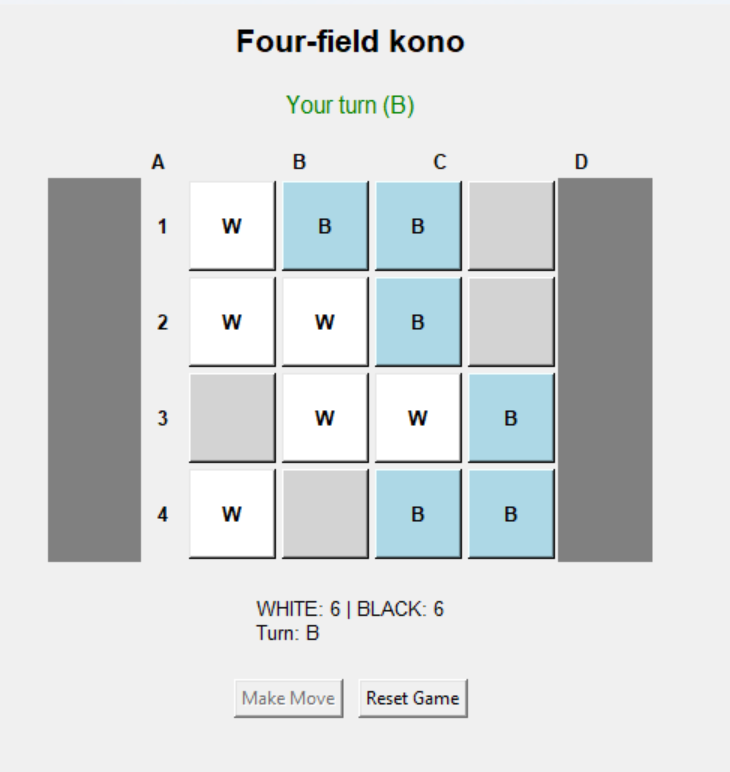

# Four-Field Kono

A Python implementation of **Four-field kono**, a two-player Korean strategy game played on a 4×4 board, where you play against a computer opponent driven by a **minimax search with alpha-beta pruning**.

The game can be played in the console or in a **Tkinter GUI**, both built on the same game logic.



## Features
- Human vs. computer gameplay, with a choice of who starts
- Computer opponent using minimax with alpha-beta pruning (configurable search depth)
- Full move validation: moves to adjacent empty squares and captures by jumping
- Two interfaces sharing the same layers: console UI and Tkinter GUI
- Unit tests for the game logic and the AI

## Architecture
Layered design, so the interfaces never touch the game rules directly:

```
game/
├── model/        # Board, Player, State
├── repository/   # game state storage
├── controller/   # rules, move validation, minimax AI
├── view/         # console UI and Tkinter GUI
└── tests/        # unit tests
```

## How to run
Requires Python 3.10+ (Tkinter is included with standard Python).

```bash
# GUI version
python run_gui_game.py

# Console version
python -m game.view.view
```

## Running the tests
```bash
python -m unittest discover
```
